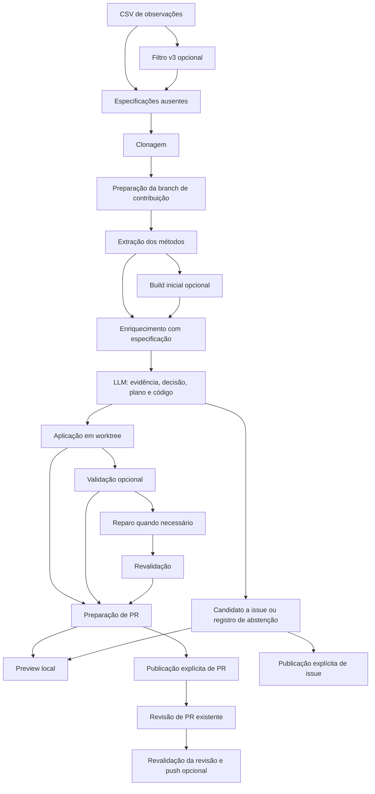
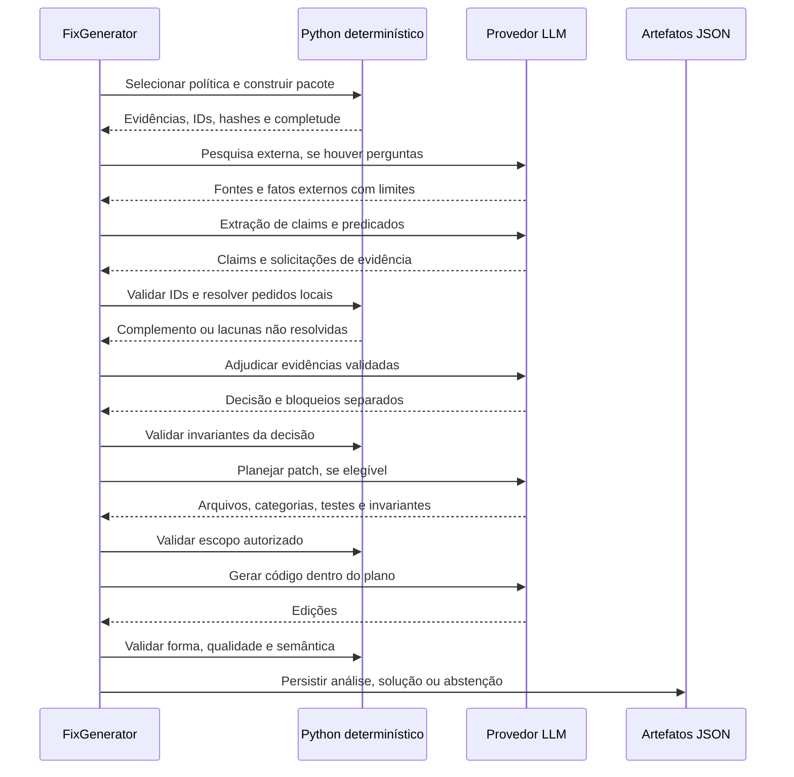

# Como o pipeline funciona

[Índice da documentação](README.md)

## 1. O problema que o projeto resolve

Uma linha do CSV informa que um analisador observou algo em uma classe e método de uma aplicação Android. Isso não informa, por si só, qual mudança é segura. O método pode pertencer a uma biblioteca, ter sido renomeado na branch atual, depender de um formato persistido ou usar uma API de maneira permitida pela plataforma e rejeitada por uma regra mais restrita do detector.

O pipeline recupera o código e as informações necessárias para responder três perguntas separadas: **o que foi observado**, **qual conclusão as evidências sustentam** e **qual mudança pode ser proposta e validada**. Uma execução pode terminar com patch, proposta para revisão, candidato a issue, falso positivo confirmado, ausência de correção segura ou falha operacional.

Há dois níveis de controle. `src/cognalys/orchestration/run_pipeline.py` (chamado por `cognalys run`) executa etapas como subprocessos. Dentro da etapa `llm`, `FixGenerator` controla os findings e as chamadas ao modelo. Um subprocesso pode processar vários projetos; um finding pode exigir várias chamadas, complementação de contexto e novas tentativas de geração.

## 2. Vocabulário necessário

| Termo | Significado neste projeto |
|---|---|
| Observação/achado/finding | Unidade analisada, identificada por dados do CSV e um identificador preservado nos artefatos. |
| APK | Artefato Android observado; também serve como agrupador de diretórios. Não é sinônimo de repositório nem de finding. |
| `spec` | Regra/especificação associada ao achado; seu contexto fica em `data/specifications/`. |
| Predicado do detector | Condição que a regra verifica. Uma violação desse predicado não implica automaticamente impacto de segurança em runtime. |
| Evidência | Fonte, relação semântica, diagnóstico ou outro dado catalogado com identidade e procedência. |
| Claim | Afirmação estruturada do modelo, acompanhada de estado e referências às evidências que a sustentam. |
| Adjudicação | Decisão sobre causa, violação, impacto, compatibilidade, geração e publicação. |
| Plano de patch | Lista de arquivos, símbolos e categorias de edição autorizados, com testes e invariantes. |
| Worktree | Checkout Git adicional ligado ao repositório base; cada tentativa de patch pode ter sua própria branch e diretório. |
| Baseline de build | Compilação/testes do código base, utilizada para distinguir regressão do patch de falha preexistente. |
| Review-only | Decisão que exige revisão humana para aplicação/publicação conforme os gates correspondentes. |
| Resume | Ignorar soluções já produzidas. É diferente de reutilizar respostas individuais do cache. |

## 3. Fluxo de ponta a ponta



As setas representam dependências de dados. A execução concreta segue a lista ordenada de etapas selecionadas, sem executar todas as alternativas do desenho. No código, `PIPELINE_STEPS` contém:

```text
rv_import → filter_v3 → spec_generation → cloning → repository_setup → extraction
→ build → spec_context → detector_rules → llm → solutions → validation → validation_fix
→ revalidation → prs → preview → publish → fix_prs
→ revalidation_fix_prs → issues → issues_cleanup
```

Sem flags adicionais, a seleção começa em `spec_generation` e inclui:

```text
spec_generation → cloning → repository_setup → extraction → spec_context
→ detector_rules → llm → solutions → prs → fix_prs → revalidation_fix_prs
```

Isso é a **seleção inicial**. O orquestrador ainda pode eliminar etapas sem trabalho a partir dos relatórios. `fix_prs` e sua revalidação dependem de registros de PR já existentes. Em uma execução nova, normalmente não há revisão publicada a processar.

## 4. Orquestração, caminhos e erros

Fonte: [src/cognalys/orchestration/run_pipeline.py](../src/cognalys/orchestration/run_pipeline.py).

`parse_args()` define a interface. `resolve_paths()` transforma caminhos em absolutos relativos à raiz e distingue o CSV original do CSV efetivo após filtro. `PipelinePaths` transporta esses diretórios. `selected_steps()` aplica `--only`, `--start-from`, flags opcionais e `--skip`. `STEP_COMMAND_BUILDERS` associa cada etapa ao construtor da linha de comando. `main()` executa os comandos em sequência com o mesmo interpretador Python e o `PYTHONPATH` preparado por `build_environment()`.

| Controle | Efeito real |
|---|---|
| `--only ETAPA` | Seleciona uma etapa, inclusive uma normalmente opcional. Não produz automaticamente seus pré-requisitos. |
| `--start-from ETAPA` | Seleciona o sufixo da sequência, sujeito às flags das etapas opcionais. |
| `--skip ETAPA` | Remove uma etapa da seleção; repita a flag para remover outras. |
| `--enable-filter-v3` | Insere o filtro e passa seu CSV de saída aos consumidores subsequentes de CSV. |
| `--validate-build` | Habilita `validation`, `validation_fix` e `revalidation`. |
| `--generate-previews` | Inclui `preview`. |
| `--publish-prs` / `--publish-issues` | Incluem as operações de publicação correspondentes. |
| `--project` | Restringe o projeto/APK, com o nome exato esperado pelos diretórios e etapas. |
| `--limit` | Limita unidades nas etapas que recebem o argumento; não é um limite global de tokens ou de chamadas. |
| `--continue-on-error` | Continua após erros e ainda reporta falha final. |
| `--ignore-step-errors` | Continua e pode terminar com código zero mesmo havendo falhas registradas. |
| `--cleanup` / `--cleanup-issues` | Selecionam fluxos específicos de limpeza, com suas opções de confirmação. |

Uma sutileza: `--start-from validation` habilita o trio de validação. Para executar `validation_fix` isoladamente, use `--only validation_fix`; começar em uma etapa não equivale a habilitar todas as etapas opcionais posteriores.

Antes dos subprocessos, `run_preflight()` verifica se os módulos declarados em `requirements.txt` são importáveis e executa análise estática com Pyflakes em `src/` e `scripts/`. O preflight não roda a suíte de testes, não testa a API do provedor e não garante disponibilidade do SDK. `--skip-preflight` desativa essas verificações.

Os erros de `spec_generation`, `spec_context` e `detector_rules` são convertidos em avisos pelo orquestrador. Para as outras etapas, consulte também `utils.step_outcome`: ele distingue sucesso (`0`), falha (`1`) e sucesso parcial (`3`), permitindo separar lotes parcialmente processados de lotes sem resultados. Erros de uso normalmente retornam `2`. Uma execução sem etapa falha termina com `3` quando alguma etapa foi parcial, mesmo que uma etapa de contexto também tenha dado aviso (antes, o aviso fazia a execução sair com `0`); só avisos dão `0`. A fila (`outputs/rvsec_auto/run_settle.sh`) decide pelo `cognalys status --resume-check`, não pelo código de saída. O código final do orquestrador e os relatórios devem ser lidos juntos; código zero não significa que todos os findings receberam correção.

Na conclusão do `main()` observado, falhas têm prioridade, depois avisos de contexto, depois sucesso parcial. Assim, uma execução que tenha simultaneamente avisos de contexto e etapas parciais, mas nenhuma falha, percorre o ramo de avisos e termina com zero; uma execução somente parcial termina com `3`. Essa é uma particularidade da implementação atual, não uma garantia de cobertura total.

Após `solutions`, a condição de ausência de soluções é **`total_solutions == 0` no relatório**. Ela não equivale a verificar apenas `successfully_applied == 0`. Sem candidatos `*_issue.json`, `issues` também pode ser omitida. `--force-downstream-steps` impede essas omissões. Após `validation`, `validation_fully_passed()` pula reparo/revalidação quando os registros de build examinados têm `status == "success"`; essa função não usa toda a lista de estados aceitos para publicação e ignora entradas sem um objeto `build_validation`. `--force-revalidation` força o novo ciclo.

`--dry-run` é repassado apenas às etapas que o suportam. O orquestrador continua criando diretórios e executando subprocessos; etapas de contexto e previews não se tornam automaticamente operações sem escrita. Para apenas consultar argumentos, use `--help`.

## 5. Entrada e amostragem

Fontes: [filtro_v3.py](../legado/scripts/filtro_v3.py), [extração](../src/cognalys/extraction/extract_methods_single_csv.py).

Os campos centrais são `apk`, `class`, `method`, `spec`, `message` e `unique_msg`, acompanhados de `repo_url`, `repo` e/ou `apk_url` conforme o CSV. O extrator normaliza esses dados antes de localizar repositórios e fontes. Um catálogo de PRs com `repo_url` pode servir para seleção/clonagem, mas, sem classe e método, não representa a mesma entrada que um CSV de findings.

O filtro v3 consulta o catálogo F-Droid, associa pacote a repositório e marca se a classe pertence ao aplicativo ou a um domínio externo. Usa programação inteira com PuLP para escolher uma observação por APK elegível, priorizando cobertura de especificações, diversidade de domínios e proximidade da distribuição da população. A versão v3 preserva classes externas; `filtro.py` e `filtro_v2.py` as descartam por prefixo do pacote.

O filtro não prova que um finding é corrigível. Ele constrói uma amostra. `rank_pr_candidates.py` faz uma priorização posterior com razões explicáveis, também sem substituir a adjudicação.

## 6. Especificações

`generate_specifications.py` lê as especificações necessárias no CSV e gera somente as ausentes, salvo `--overwrite-specifications`. O caminho usa OpenAI e pesquisa externa. A resposta deve satisfazer o schema e verificações locais; rejeições têm registro próprio. `enrich_spec_context.py` carrega o registro de especificações e anexa contexto aos JSONs extraídos.

Uma especificação distingue:

- `detector_semantics`: o que a regra detecta;
- `api_semantics`: comportamento/precondições da API;
- `security_semantics`: relação e limites entre o predicado e uma conclusão de segurança;
- `evidence_requirements`: dados necessários para sustentar a análise;
- `source_verified`, fontes e tipos governados: procedência e aplicabilidade;
- eventos, parâmetros desconhecidos e inferências proibidas sem evidência.

Esses campos são dados de entrada e não decisões finais. `audit_specifications.py` verifica a correspondência entre especificações e as fontes que declaram; uma URL válida sozinha não prova que o texto contém a regra correta. A documentação aqui descreve as especificações locais, sem reauditar suas fontes remotas.

## 7. Clonagem, revisão analisada e branch de contribuição

`cloning` e `extraction` são construídas por `_command_cloning()`, com opções diferentes para separar a aquisição do repositório da extração. `SingleCsvMethodExtractor` lê CSV, organiza APKs, clona com timeout/retries e reutiliza clones conforme as opções. Há recuperação de checkout incompleto e suporte a revisão indicada nos dados: o commit indicado é buscado com `--depth 1` (por SHA, depois por tag) e, se não vier, o histórico é aprofundado uma vez (`fetch --unshallow`); o commit em que o clone ficou é gravado como `checked_out_revision` ao lado de `pinned_revision`. Se o commit indicado não pôde ser posto, os achados do APK são gravados com `extraction_status: pinned_revision_unavailable` e fecham como não analisáveis antes de qualquer chamada ao modelo: o branch padrão é outro código, não o que o RVSec executou.

`repository_setup` chama `prepare_repository_branches.py`, que lê orientações descobertas por `repository_guidance.py`, identifica a branch recomendada e registra o resultado em `application_results/repository_setup.json`.

A revisão na qual o APK foi analisado pode ser antiga. A branch que receberia uma contribuição pode já não ter o arquivo ou o mesmo código. `utils/contribution_base.py` centraliza a resolução da base e as consultas sobre existência do alvo. A extração registra essa diferença cedo; o aplicador pode classificar o resultado como `NOT_APPLICABLE_TO_BASE` se o patch não se aplica ali. Quando o porte por LLM responde `ALREADY_FIXED_UPSTREAM`, a resposta só é aceita com confirmação determinística (`port_already_fixed_confirmation`, B5): a linha reportada, lida na revisão analisada, não está em nenhum arquivo da base (`statement_on_branch`), ou o código corrigido de cada edição já está na base e o original não (`already_on_base`). Sem confirmação o porte vira `ABSTAIN` com `PORT_ALREADY_FIXED_UNCONFIRMED` (a resposta do modelo fica em `base_port.model_decision`) e o achado fica em "correção gerada, sem PR", nunca em "correção não aplicável" pela palavra do modelo. Um porte que escreve uma linha que nenhuma edição revisada escrevia (`port_changes_correction`, B6; a linha de contexto que o porte traz da base não conta) passa pela revisão de comportamento antes de ser aplicado, com o cliente do porte: uma regressão ou um patch sem efeito rejeita o porte, que volta uma vez com o cenário, como as objeções das checagens semânticas; uma decisão de mantenedor é nota; as revisões ficam em `base_port.behavior_reviews`. Isso não invalida automaticamente o interesse científico da análise da revisão histórica. `resolve_base_ref` sempre devolve uma ref qualificada (`refs/heads/<branch>` ou `refs/remotes/<remote>/<branch>`), nunca o nome curto: no TagMo, a branch base e uma tag têm o mesmo nome curto `master`, e um `git rev-parse`/`git worktree add` com o nome cru resolve para o objeto errado (a tag) só com aviso, ou falha de vez (`fatal: ambiguous object name`) — foi isso que derrubou a run inteira (`run_20260927_175748`) por causa de um único finding, antes mesmo de `validation`/`prs` rodarem para os outros nove. Qualificar a ref elimina a ambiguidade para qualquer repositório com uma branch e uma tag (ou uma branch e outro remoto) de mesmo nome, não só para esse repositório. Corrigido esse crash, a mesma run (`run_20260927_175748`) expôs outro, também de ambiente e não do patch: o `.gitmodules` do TagMo declara o submódulo `amiitool` via SSH (`git@github.com:...`), e a máquina de build não tem chave SSH nem `known_hosts` configurados (`Host key verification failed`). `builds/apk_build.py`'s `rewrite_dead_submodule_protocols` já existia para o caso do protocolo `git://` (desativado pelo GitHub em 2022) — reescreve a URL para `https://` via `insteadOf` passado por variável de ambiente, porque um clone de submódulo só lê config de sistema/global, nunca o `--local` do superprojeto. `_SUBMODULE_URL_REWRITES` generaliza isso para uma lista de regras (`git://`, `git@github.com:`, `ssh://git@github.com/` → `https://`/`https://github.com/`); cada transporte realmente encontrado no `.gitmodules` ganha exatamente uma entrada `insteadOf`, cobrindo qualquer submódulo que a use, sem tocar no `.gitmodules` nem na revisão do checkout.

## 8. Extração e expansão do contexto

`RepositoryIndexer` localiza arquivos Java/Kotlin pelo nome de classe. `MethodExtractor` trata métodos, construtores, inicializadores e nomes derivados do bytecode Kotlin, incluindo classes internas e indicações de linha. O JSON inicial inclui, entre outros:

```text
extraction_metadata   CSV, APK, repositório, revisão, status, timestamp
error                 classe/método do CSV, mensagem, unique_error_id, spec, tool
class_info            classe, caminho da fonte, relative_method_file
method_info           nome no código, intervalo de linhas, mapeamentos
source_code           corpo exato, imports, entorno e chamadas
repository_guidance   orientações encontradas no repositório
branch_policy         política de branch inferida
dependency_context    evidência de dependência quando aplicável
```

O formato é um mapa orientador, não um JSON mínimo válido: variantes de extração acrescentam campos, e findings de dependências podem ter corpo e caminho vazios.

Quando uma classe não é encontrada, o extrator pode produzir `external_dependency_candidate` e coletar evidência de dependências. Não encontrar a classe no clone não comprova automaticamente um falso positivo nem fornece o código da biblioteca. O resultado continua limitado pelo que foi encontrado.

A etapa LLM expande a extração com componentes especializados:

| Módulo | Evidência acrescentada e limite |
|---|---|
| `repository_index.py` | Arquivos e ocorrências no repositório, com busca limitada e fallback portátil. |
| `semantic_index.py` | Símbolos/chamadas Java e Kotlin via Tree-sitter; resolução e ambiguidades. Não substitui o compilador. |
| `multi_file_context.py` | Impacto sobre consumidores, implementações relacionadas, constantes e testes; fontes exatas candidatas e requisitos de cobertura. |
| `value_usage_graph.py` | Atribuições, propagação por campos/wrappers, comparações, sinks e relações de uso com endereços no código. |
| `migration_context.py` | Persistência, formatos, protocolos, cache, variantes Android, consumidores e compatibilidade de migração. |
| `dependency_context.py` | Dependências declaradas/resolvidas, versões, constantes e atribuição de classe externa. |
| `sink_reachability.py` | Caminhos locais, dentro de métodos, até usos relevantes; não faz execução dinâmica nem prova alcançabilidade global. |

O contexto pode ser parcial. Relações lexicais de mesmo nome não viram automaticamente chamadas semanticamente resolvidas. Exclusões, ambiguidades e limites de orçamento devem continuar visíveis nos artefatos.

**Vínculo de chamadas pelo bytecode.** Quando a classe está no checkout, a extração também grava `apk_bytecode` (`apk_evidence.collect_method_bytecode_bindings`): as instruções `invoke-*` do método reportado no APK analisado, cada uma resolvida por `extraction/bytecode_binding.py` até o tipo que declara o método, subindo a hierarquia pelas `class_defs` do próprio dex (`declared_in_apk`, ou `outside_apk` quando a subida chega a um tipo da plataforma ou de biblioteca não empacotada). O fato derivado `call_binding` usa isso para fechar chamadas que o texto não resolve — sem receptor (`getIntent()` herdado), receptor expressão (`intent.data!!.buildUpon()`), receptor de código gerado (`binding.webview.loadUrl`) — quando nome e aridade apontam um único tipo (`resolution: bytecode_invocation`); chamadas que só o bytecode mostra (propriedade Kotlin compilada para setter) vão em `bytecode_only_calls` sem alterar o status, porque o APK pode ser de outra revisão. Em `run_20260927_175748` foi isso que faltou aos advisories do Home Assistant e do WordPress. Desligado junto com a evidência de APK por `TCC_SKIP_APK_EVIDENCE`.

**Causa confirmada por advisory publicado.** Um finding que cita um advisory (CVE, GHSA, GHSL, OSV) e foi analisado na revisão fixada que o advisory descreve tem autoridade independente da leitura do fonte (`independent_finding_authority`). Se a adjudicação o bloqueou só por `cause_unconfirmed` e por categorias que um humano decide, `promote_authority_confirmed_cause_to_review` o gera para revisão, atribuindo a causa ao advisory em `confirmed_cause` e numa premissa de revisão; bloqueios de fonte ausente ou alvo não resolvido continuam impedindo. O retrospecto mede `known_positive_abstention`: quantos desses positivos conhecidos terminaram sem patch, sem depender de rótulos de revisor.

**Runs retomadas por projeto.** Uma invocação com `--project` preserva, em `execution_report.json`, as entradas dos outros projetos (o `workflow_status`, que decide o código de saída, continua descrevendo só a invocação atual); `step_timings.json` acumula as etapas de todas as invocações da run; e uma solução gerada que nenhuma invocação aplicou recebe a assinatura `apply:not_run` no retrospecto.

**Regras Semgrep propostas (`detector_rules`).** Antes de `llm`, `legado/scripts/propose_detector_rules.py` pede ao modelo uma regra para cada especificação do CSV que ainda não tem uma, e `validation/rule_proposal.py` só a aceita se o Semgrep, rodando de verdade, concordar com o que se sabe: a regra dispara no método de todo finding que uma pessoa (`static:manual`) ou um advisory na revisão fixada sustenta (findings de detectores automáticos também são rodados, e pelo menos um finding precisa disparar); roda também o mesmo método na branch base quando ele mudou depois do advisory, mas só registra o resultado, porque a correção pode ter ido para outro lugar (no Omni-Notes o método só trocou `Toast.LENGTH_SHORT` por `LENGTH_SHORT`); e acerta os exemplos violadores e conformes que o próprio modelo escreve (um conforme por forma de falso positivo documentada). Falhou, a regra volta ao modelo com cada caso que falhou, até três vezes; uma especificação cujo reparo não é local ao método recebe `not_local` e nenhuma regra. A consistência entre runs vem de: a run só lê as regras; regra escrita à mão nunca é tocada; regra aceita só é refeita com `--replace`; `not_local` só é reavaliado se a especificação mudar, e `rejected` só quando aparece um caso real que ainda não foi visto (evidência que só diminuiu, por poda de clones, não conta); cada decisão, com todos os casos e resultados, fica em `data/detector_rules/semgrep/generated_rules.json`, e o diretório entra no manifesto do experimento. Uma regra aceita cuja especificação mudou é apenas reportada como desatualizada, nunca regenerada sozinha.

**Texto do PR.** O título vem da justificativa da principal edição de produção ("Enable WebView debugging only for debug builds") em vez de `Fix <método>`. No resumo, frases que descrevem o que a evidência não estabelece ou que falam do detector/pipeline são descartadas. O PR não tem mais a seção `## Before merging`: as perguntas em aberto da adjudicação (`publication_considerations`) ficam só no JSON, para o operador.

## 9. A etapa LLM por dentro

Fontes: [generate_error_fixes.py](../src/cognalys/llm/generate_error_fixes.py), [pipeline_architecture.py](../src/cognalys/llm/pipeline_architecture.py).

**Onde está o código.** `generate_error_fixes.py` mantém o `FixGenerator` (construtor, `run_analysis`, relatórios) e o `main`; os estágios são mixins que ele herda: [finding_discovery](../src/cognalys/llm/finding_discovery.py) (o que entra na run e o que se fecha antes de qualquer chamada ao modelo), [finding_context](../src/cognalys/llm/finding_context.py) (contexto do repositório), [finding_adjudication](../src/cognalys/llm/finding_adjudication.py) (`adjudicate_finding`: extração de evidência, pesquisa, adjudicação e plano), [coordinated_generation](../src/cognalys/llm/coordinated_generation.py) (geração arquivo a arquivo), [issue_candidates](../src/cognalys/llm/issue_candidates.py) e [finding_processing](../src/cognalys/llm/finding_processing.py) (`process_finding`, do finding ao desfecho, e o pool de workers); constantes e auxiliares comuns ficam em [fix_generation_common](../src/cognalys/llm/fix_generation_common.py). `pipeline_architecture.py` só reexporta: [pipeline_common](../src/cognalys/llm/pipeline_common.py) (versões e hash), [false_positive_rules](../src/cognalys/llm/false_positive_rules.py), [source_facts](../src/cognalys/llm/source_facts.py) (fatos lidos do fonte, bytecode e build), [research_questions](../src/cognalys/llm/research_questions.py), [evidence_packet](../src/cognalys/llm/evidence_packet.py), [llm_contracts](../src/cognalys/llm/llm_contracts.py) (schemas e vocabulários de decisão) e [adjudication_rules](../src/cognalys/llm/adjudication_rules.py) (validações e roteamentos pós-adjudicação). Uma refatoração que não deve mudar comportamento é conferida com `legado/scripts/refactor_replay.py --baseline <antes> --candidate <depois>`, que reexecuta a etapa LLM sobre findings gravados com as respostas reais do modelo e compara prompts, artefatos, textos de PR e registros do retrospecto.

`discover_errors()` normaliza os JSONs de métodos. `run_analysis()` organiza o lote, resume quando permitido e agrega resultados. `analyse_findings()` pode processar findings concorrentemente com `--llm-workers`; o padrão é um. `FindingOutcome` carrega o resultado individual para evitar que estado compartilhado confunda decisões entre threads.

`process_finding()` coordena análise, gates, geração, validações locais e persistência do finding. Dentro dele, `adjudicate_finding()` executa o fluxo estruturado abaixo. A distinção ortográfica é importante para navegar neste arquivo.



### 9.1 Políticas e pacote de evidências

`classify_spec_family()` classifica a família (`tls`, `cipher`, `message_digest`, `key_generation`, `dependency` ou `generic`). `PolicyRegistry` combina a política comum e a da família. `migration_policy.py` resolve políticas específicas do finding e deriva limites conservadores de compatibilidade.

`FindingEvidencePacketBuilder.build()` monta um catálogo com identificadores, tipos, níveis de confiança, hashes e dados. A fonte alvo e declarações obrigatórias recebem tratamento prioritário; exclusões por orçamento são registradas. O orçamento `--repository-context-budget` é medido em **caracteres**, enquanto `--ollama-context-length` é a janela do Ollama em **tokens**.

Não some o número de entradas do catálogo como se todas fossem provas independentes. Uma relação pode derivar da mesma fonte. `canonical_json()` e `canonical_hash()` ajudam a identificar exatamente os dados usados, sem transformar inferência em observação de runtime.

O diagnóstico bruto do detector, por exemplo `DET-001`, aparece como contexto em `diagnostic_evidence`, com autoridade de decisão ausente. Ele não é um ID de suporte aceitável para confirmar a própria alegação. Claims/predicados devem apontar para entradas válidas do catálogo local ou externo. Isso evita a circularidade de justificar uma vulnerabilidade apenas repetindo o alerta que iniciou a análise.

### 9.2 Pesquisa externa

A pesquisa responde perguntas delimitadas sobre regra, API, constantes, advisory e compatibilidade. Fontes externas recebem IDs `WEB-*`; isso não lhes dá a mesma autoridade que o código exato do repositório sobre o comportamento daquele aplicativo.

Uma recusa de conteúdo do provedor é representada por `ProviderContentRefusal`, diferente de timeout ou falha HTTP transitória. Na pesquisa complementar, recusas e falhas previstas ficam registradas e a análise pode continuar com as evidências locais. Não há garantia de que os dados restantes sejam suficientes para autorizar um patch.

### 9.3 Extração de evidências e complementação

O modelo retorna claims, predicados, fluxos e questões pendentes. `validate_evidence_extraction()` e `sanitize_evidence_extraction()` verificam a ligação com o catálogo; uma afirmação confirmada precisa de referências válidas. `evidence_requests.py` classifica `requested_evidence` e procura declarações, testes e configurações disponíveis no repositório.

Predicados são formulados como requisitos positivos: `confirmed` significa que o requisito é satisfeito; `violated`, que foi violado; `unknown`, que a evidência não decide. Um predicado confirmado não significa uma vulnerabilidade confirmada. Também há diferença entre não encontrar algo no escopo examinado e comprovar sua ausência em todos os caminhos relevantes.

`_supplement_evidence()` persiste o complemento e a primeira extração quando uma nova rodada é necessária. Pedidos de observação real de runtime não se tornam respondidos apenas porque foi localizada uma ocorrência textual.

### 9.4 Adjudicação e invariantes

A adjudicação separa causa, violação do detector, impacto em runtime, compatibilidade, geração e publicação. `validate_adjudication()` impede conclusões incompatíveis com os claims. A dispensa (`detector_violation: not_confirmed`) é verificada como a geração (`dismissal_justification_issues`, B1): precisa de `decision_claim_ids`; cada afirmação citada precisa estar `confirmed` e apoiada em evidência do repositório, do APK ou da especificação (não só `DET-*` ou `WEB-*`); e a causa não pode se apoiar num padrão de falso positivo que a revisão de padrões não manteve (`unreviewed_false_positive_shapes`, ou um padrão nomeado quando a regra não tem padrão revisado). Uma dispensa recusada passa pela correção da adjudicação; se continuar recusada, a violação vira `unknown` ("evidência insuficiente"), nunca falso positivo. O código não dispensa nada por conta própria. Existem verificações determinísticas adicionais para tipos governados, sobrecarga/quantidade de argumentos, falsos positivos documentados, código vendorizado e violações colaterais.

O código pode solicitar uma correção da resposta estruturada quando ela falha nos contratos. Não existe uma quantidade universal de chamadas por finding: pesquisa, complementação, correção de adjudicação/plano e novas tentativas de geração alteram essa quantidade.

Exemplos de decisões que aparecem no fluxo incluem `FIX_SUPPORTED`, `MULTI_FILE_FIX_PROPOSED_FOR_REVIEW`, `BACKEND_MIGRATION_REQUIRED_REVIEW_ONLY`, `MULTI_REPOSITORY_MIGRATION_SUPPORTED` e `NO_SAFE_FIX`. Estados de apresentação como `CONFIRMED_FALSE_POSITIVE` não devem ser confundidos com sucesso de aplicação.

### 9.5 Plano antes do código

O plano define `required_edits`, caminhos, símbolos, categorias, claims de suporte, testes e invariantes. `PatchScope` deriva o conjunto de arquivos de produção e de teste desse plano. Um teste novo não faz, sozinho, uma correção de um único arquivo de produção virar uma migração entre vários arquivos de produção.

O patch gerado carrega `authorized_patch_plan`. Gerar uma solução não autoriza o aplicador a escrever em qualquer caminho. Categorias como método, declaração, constante, teste, criação e remoção têm verificações próprias.

### 9.6 Geração e validação local

Toda decisão que gera patch passa por `generate_coordinated_file_drafts()`, que produz drafts por arquivo e manifesta o progresso (B3, 2026-11-12). Uma correção `FIX_SUPPORTED` ou `SAFE_INTERNAL_DIGEST_MIGRATION` cujo plano só edita o método reportado vai por esse caminho com a própria decisão; quando o plano não lista edição, `one_method_edit()` nomeia o método reportado como a única. Assim as checagens coordenadas, a revisão de comportamento, as novas tentativas e o replanejamento valem para todo patch. O antigo gerador de método único (`build_single_fix_prompt()`, `single_fix_schema()`) foi removido; soluções gravadas com `fix_scope: single_method` continuam sendo lidas, aplicadas e portadas por `solution_mapper.replace_method_status`. `ResponseParser` interpreta a resposta.

`semantic_validation.py` verifica forma das edições, cobertura de arquivos, referências a APIs/símbolos, posicionamento de testes, construtores e riscos de ciclo de vida/compatibilidade. Essas verificações são heurísticas determinísticas sobre a fonte; não equivalem a um verificador formal ou à compilação completa. Falhas podem orientar novas tentativas somente nos alvos necessários.

O resultado pode ser recusado mesmo após uma adjudicação favorável. `post_validation_issue_candidate()` e `collateral_issue_candidate()` tratam situações em que há evidência útil para comunicação, mas não um patch validado. A comunicação é construída depois da análise e não deve acrescentar alegações técnicas novas.

## 10. Estados que não devem ser confundidos

Fonte central: [utils/disposition.py](../src/cognalys/utils/disposition.py).

| Pergunta | Onde procurar |
|---|---|
| A análise terminou ou ocorreu erro operacional? | `FindingOutcome.success`, `outcome`, `failure_cause` e tracking. |
| Qual foi a conclusão técnica? | Adjudicação e `decision`. |
| Exige revisão humana antes de aplicar? | `FindingDisposition.needs_human_review`, flags persistidas e gate do aplicador. |
| Pode ser aplicado para build? | `appliable`, `auto_apply` e eventual aprovação específica para validação. |
| A publicação está bloqueada? | `publication_status`, `publication_allowed` e bloqueios de adjudicação. |
| A escrita no worktree ocorreu? | Status individual em `per_solution_details`. |
| Compilou? | `build_validation.status`, fases, tarefas e logs. |
| Foi publicado? | Registro `*_pr_created.json`/registro de issue e resposta do GitHub. |

Um bloqueio de publicação, isoladamente, **permite continuar a aplicação para validação** quando a decisão não exige revisão prévia. Review-only pode ser aplicado com `--approve-review-only-for-validation`, mas essa opção não autoriza publicação. `--approve-reviewed-finding FINDING_ID` é o controle explícito para findings revisados na etapa de publicação; ele não substitui os demais gates. A publicação também é recusada quando uma run anterior já abriu um PR para o mesmo finding e ele pode continuar aberto (o estado é consultado no GitHub; se a consulta falha, o bloqueio permanece); `--allow-duplicate-pr` abre outro de propósito.

`FindingOutcome.outcome` tem uma particularidade: seu default é `failed`, inclusive em alguns objetos com `success=True`; o agregador verifica `success` primeiro. Não conte falhas apenas agrupando `outcome` sem considerar esse contrato.

## 11. Aplicação isolada e atômica

`run_apply.py` monta `ApplySolutionsConfig` e chama `SolutionApplicator`. `SolutionMapper` descobre as soluções, resolve `relative_method_file` e mapeia o arquivo para o clone. `WorktreeManager.prepare()` resolve a base e cria/reutiliza um checkout por finding e revisão de solução.

O caminho típico é `finding_worktrees/<projeto>/<finding_id>/<revisão>/`; a branch incorpora método, especificação, finding e revisão. Um worktree já alterado por tentativa anterior não é simplesmente considerado limpo: o gerenciador pode criar uma nova tentativa com sufixo. Diretórios órfãos são preservados e registrados. O clone base precisa estar limpo, com tratamento específico para ruído de fins de linha.

Antes da escrita, o aplicador verifica autorização de escopo, fonte original, hashes quando disponíveis, localização única e forma das alterações. `coordinated_edits.apply_edits_to_sources()` aplica o conjunto à representação em memória, resolve imports e rejeita âncoras ausentes ou ambíguas. `scope_utils.py` detecta erros comuns de escopo léxico Kotlin/Java. O aplicador faz backups e controla a gravação/recuperação do conjunto, evitando deixar apenas parte de uma correção coordenada aplicada.

**Assinaturas alteradas e chamadores.** `solutions/signature_change.py` compara, em texto puro, as declarações de `original_code` e `corrected_code` e reconhece default removido, parâmetro removido, parâmetro obrigatório novo, mudança de aridade (Java) e constante `ALL_CAPS` apagada. A validação semântica (`SIGNATURE_CHANGE_BREAKS_CALLERS`, `REMOVED_CONSTANT_STILL_REFERENCED`) procura, no repositório como o patch o deixaria, chamadas que ainda usam a forma antiga. Só fala quando lê a chamada por inteiro (argumentos balanceados, sem lambda final, sem spread) e quando o receptor tem o tipo declarante ou o nome é único no repositório; sobrecargas e formas incomuns ficam em silêncio. O erro volta ao gerador como feedback de nova tentativa, com a lista `arquivo:linha`. Se nenhuma assinatura muda, nada é lido do repositório. Na validação de build, um diagnóstico em linha que o patch não escreveu mas que cita um símbolo alterado recebe a atribuição `caller_of_changed_symbol` (conta como falha do patch, com orientação de regeneração própria) em vez de `preexisting_test_or_source_debt`. Um worktree cujo build anterior falhou ao compilar é revalidado sem `clean` (`incremental_after_failed_build`); após sucesso, o build limpo é mantido. Na revalidação, só são reconstruídos os findings reparados e os que não passaram (`--revalidate-repaired-in`; `--full-revalidation` restaura o comportamento antigo), e um reparo que tocou apenas fontes de teste após uma produção aprovada reaproveita o registro dessa produção (`reused_after_test_only_repair`, pois `assembleDebug` não compila conjuntos de teste; reconstruir sem `clean` deixaria as APKs mais antigas que o início do build e `find_apks` as recusaria como obsoletas). A validação semântica também aponta chamada a membro Kotlin que nenhum arquivo do repositório declara (tipo sem supertipos externos, sem anotação geradora), como o `getUpdateQueryParameterNamesForTest` inventado num teste. Parâmetros removidos ou sem default que o finding não cita (palavras do nome comparadas com a mensagem, a causa confirmada e a estratégia, nunca com as razões do próprio patch) geram `UNRELATED_PARAMETER_CHANGED`. Quando uma nova tentativa faz um arquivo de produção abandonar API pública que ele tinha acrescentado (`UNNECESSARY_PUBLIC_API_EXPANSION`), os testes do plano são regenerados junto. O reparo de validação passa pelos mesmos gates semânticos, lidos contra o worktree e só sobre as edições do reparo; uma rejeição (`repair_violates_semantic_gates: CODE`) volta ao modelo como erro de aplicação antes de qualquer arquivo ser escrito. O pacote de evidências ganha o fato derivado `input_flow` (`evidence_facts.user_input_parse_flow`): chamada de parse alimentada direto por widget cujo tipo termina em `EditText`, se um `try` que captura a falha a envolve e se roda em callback do framework; vale para qualquer família de parse e qualquer especificação, e traz `validation_search`, uma busca no repositório (Java/Kotlin e layouts) por chamadas de validação que citam o widget (`addTextChangedListener`, `setFilters`, `setError`...), checagem de vazio no método, atributos do layout do id da view (`inputType`, `maxLength`, `digits`), helpers que recebem o widget e handlers globais de exceção; `no_validation_found_for_any_widget` transforma "não há validação" em fato (não lê código gerado no build). A validação semântica reprova import adicionado de um pacote que nada no repositório declara ou usa quando o repositório já importa a mesma classe de outro pacote e nenhuma outra parte da mesma família de pacote é usada (`IMPORT_PACKAGE_NOT_IN_REPOSITORY`; um group id do Gradle não é nome de pacote). O texto do PR reescreve "Generate a … change that …" para "This change …" e descarta frases dirigidas ao revisor ou ao pipeline. Os itens de `blocking_for_publication` da adjudicação (categoria, descrição) já sobrevivem intactos em `evidence_analysis.v2.adjudication`, mas nada os lia dali antes de chegar ao PR: `human_decided_publication_considerations` (`pipeline_architecture.py`) filtra pelas categorias que só um humano resolve lendo o patch (`HUMAN_DECIDED_BLOCKER_CATEGORIES`: `maintainer_decision`, `runtime_behavior`, `compatibility_contract`), e o resultado fica em `publication_considerations` no JSON da solução, para o operador — o corpo do PR não tem mais seção `## Before merging`. `--gradle-build-cache` (opcional) reaproveita saídas de tarefas entre builds. A retrospectiva grava `findings_index.json` (índice derivado, caminhos relativos) e aponta veredito que mudou entre runs com o `context_sha256` do contexto mostrado ao modelo.

`execution_report.json` é o contrato central das etapas seguintes. Contém `workflow_status`, configuração, contadores, `total_solutions` e `per_solution_details`. As entradas preservam caminhos, branch/base, código/edições, decisão e posteriormente resultados de build. A escrita atômica usa arquivo temporário e rename para evitar JSON truncado. As checagens estruturais são diagnósticas em alguns consumidores: registram inconsistências, mas não constituem um schema completo nem bloqueiam toda gravação inválida.

## 12. Build inicial, validação e baseline

`build` compila clones antes da aplicação quando habilitado. `validation` compila o patch no worktree. São operações com objetivos diferentes.

`apk_build.py` descobre raiz Gradle, wrapper, SDK compatível com o host, variante e APKs. Desativa minificação e resource shrinking por mecanismos de build, trata submódulos, prepara propriedades locais/assinatura de validação e registra logs/resultados. Também usa exclusão mútua para evitar builds concorrentes conflitantes sobre o mesmo projeto.

`applied_solutions.py` lê o relatório de aplicação e coordena fases de build, compilação/testes e comparação com baseline quando aplicável. Extrai diagnósticos do compilador e relatórios de testes para identificar se a falha está no código gerado ou já existia na base. Pode recuperar uma falha em módulo/variante não alterado compilando os módulos afetados e registrar um sucesso de alcance menor.

| Status | Como interpretar |
|---|---|
| `success` | As tarefas selecionadas pela validação passaram. Inspecione as fases para saber quais foram. |
| `success_app_module_only` | O módulo afetado passou após falha fora desse escopo. Não é sucesso de build integral. |
| `failed` | Houve falha que não pode ser tratada como aprovação de build. Ver diagnóstico/atribuição. |
| `infrastructure_failure` | Ambiente/repositório impediu a validação nos termos registrados. |
| `not_run` | Build não executado. |
| `timeout` | Prazo esgotado; não prova nem compilação correta nem falha exclusiva de infraestrutura. |

`BUILD_VALIDATION_PASSING_STATUSES` (`utils/disposition.py`) centraliza os cinco estados de sucesso aceitos pelos gates que a utilizam: `success`, `success_app_module_only`, `success_on_analyzed_revision`, `success_production_only_test_build_preexisting` e `success_compile_only`. A aprovação explícita `--publish-without-build-validation FINDING_ID` cobre apenas estados em que o build não rodou (`infrastructure_failure`/`not_run`) e é restrita ao finding. Ela não cobre `failed` ou `timeout`, nem autoriza por si só um finding review-only.

Depois do build, a única verificação adicional é a reexecução do detector estático (`replay_source_detector()`), registrada como medição e sem efeito no status. A rechecagem do predicado no fonte e a suíte de regressão opcional foram removidas em 2026-10-23: a primeira só reprovava patches que não tocavam o valor reportado, uma minoria rara, e a segunda nunca rodou nos casos avaliados. Nenhuma dessas etapas era uma nova execução do detector original nem observação de comportamento em dispositivo.

## 13. Reparo da validação

`repair_validation_failures.py` é o wrapper de `validation/repair.py`. O reparador recebe os diagnósticos, fontes exatas e declarações relacionadas, monta contexto limitado e pede substituições exatas via OpenAI. `validate_and_apply()` restringe os arquivos às fontes diagnosticadas e verifica a edição antes de gravar. O código também registra/commita reparos conforme o fluxo.

Esse estágio não deve reabrir a decisão de segurança ou planejar outra migração. Depois, `revalidation` repete a validação com `--fail-on-validation-error`. A primeira passagem permite encaminhar falhas reparáveis de código; falhas de infraestrutura e os códigos agregados continuam tendo tratamento próprio. Os artefatos de reparo e as novas fases de build são necessários para comprovar o resultado.

Na implementação atual, `failure_is_the_patch()` exclui atribuições comprovadamente preexistentes. Mesmo na revalidação estrita, a interrupção por falha considera essa atribuição; falha preexistente pode continuar produzindo artefatos sem se tornar aprovação de build. Infraestrutura não aprovada é contabilizada separadamente e pode retornar `2`. Portanto, continuar até os previews não significa que a compilação passou.

## 14. PRs, previews, publicação e feedback

`prs` chama `run_prs.py` e `PrGenerator.generate_prs()`. O gerador lê o relatório, resolve o repositório/worktree, calcula o diff, verifica gates, cria commit quando elegível e grava `*_pr.json`. Preparar metadados e até criar um commit local não cria um PR no GitHub.

`preview` lê PRs, candidatos a issue e evidence reviews. Produz Markdown para inspeção, inclusive para resultados sem patch. `publish` chama `AutomatedPRCreator`: autentica, verifica metadados/build/aprovações, identifica upstream e branch base, prepara fork/remotes, faz push e abre PR. Registra a resposta em `*_pr_created.json` e evita reprocessar publicações existentes, salvo opção explícita.

`issues` usa `IssueCreator` para publicar a partir de metadados ou candidatos fundamentados sem correção. `issues_cleanup` fecha issues registradas somente no modo confirmado. `cleanup_pipeline.py` tem escopo maior: PRs, branches e restauração de clones, com modo de simulação e confirmação.

Para PRs já publicados, `fix_prs` consulta estado atual/feedback e pode fazer auditoria ou tratar CI conforme flags. `pr_feedback.py` prepara a revisão e aplica as edições no checkout. `revalidation_fix_prs` chama o mesmo entrypoint com `--revalidate`: compila, verifica estilo e pode publicar com `--publish-fix-prs`. `pr_github.py` concentra acesso a feedback, CI, sign-off e operações de push; `pr_validation.py` concentra compilação e ktlint. Algumas rotas de reparo de sign-off reescrevem commits; não são simples consultas.

## 15. Artefatos e rastreamento de um finding

Os caminhos dependem das opções da run. Com os defaults Python, começam em `outputs/`; os wrappers Bash normalmente colocam os resultados em `outputs/run_<timestamp>/` e compartilham clones.

| Artefato/padrão | Produtor | Consumidor/pergunta respondida |
|---|---|---|
| `error_methods_tracked/<apk>/*.json` | Extração/enriquecimento | Qual código e contexto originaram a análise? |
| `error_solutions/v2_artifacts/<apk>/*_evidence_packet.json` | Builder | Quais evidências estavam disponíveis? |
| `*_external_research.json` | Pesquisa | Quais fatos externos foram pesquisados e quais ficaram pendentes? |
| `*_evidence_extraction.json` | Extração LLM validada | Quais claims/predicados sustentam a decisão? |
| `*_evidence_extraction_round1.json`, `*_evidence_supplement.json` | Complementação condicional | O que faltava e o que foi recuperado? |
| `*_adjudication.json` | Adjudicação | Por que gerar, revisar ou abster? |
| `*_patch_plan.json` | Planejamento | Quais edições eram autorizadas? |
| `error_solutions/evidence_reviews/` | Gerador | Visão persistida da análise, inclusive quando não há patch. |
| `error_solutions/issue_candidates/*/*_issue.json` | Gerador | Existe uma questão fundamentada para o mantenedor? |
| `error_solutions/<apk>/` | Geração | Soluções que o mapper descobrirá. Consulte `discover_solutions()` para o padrão aceito. |
| Drafts/manifests de geração coordenada | Gerador | Quais arquivos foram gerados e quais validações locais falharam? |
| `application_results/execution_report.json` | Aplicação, depois validação | O que foi aplicado, onde e com qual resultado? |
| `application_results/build_validation/` | Validador | Logs, fases, diagnósticos e feedback de build. |
| `application_results/validation_fixes/` | Reparador | Edições de reparo e resultado do estágio. |
| `application_results/openai_prompt_logs/*_{request,response,metadata}.json` | Provedor OpenAI | Prompt, resposta/erro, tokens, cache, latência e relação entre chamadas. |
| `pull_requests/*_pr.json` | Gerador de PR | Texto/diff/metadados preparados localmente. |
| `pull_requests/*_pr_created.json` | Publicador | Resultado registrado da publicação. |
| `application_results/fix_prs_report.json` | Revisão/revalidação | Resultado das revisões de PRs existentes. |
| `previews/`, `issues/` | Apresentação/publicação | Material para leitura e registros de issue. |
| `outputs/.llm_cache/` | Provedores | Respostas reutilizáveis entre runs. |

Para investigar um caso, comece pelo `unique_msg`/`unique_error_id` do CSV e pelo APK. Localize o JSON extraído; confira revisão/caminho; abra o pacote, claims e adjudicação; confronte plano e solução; siga o `finding_id` e `worktree_path` do relatório até logs e diff. Índices e nomes sanitizados ajudam a localizar arquivos, mas não substituem a identidade registrada no JSON.

`LLMResponseCache` endereça respostas por hash do request. O cache compartilhado do orquestrador fica fora das runs; pesquisa tem TTL próprio, padrão de 168 horas. `--no-llm-resume` reprocessa findings, mas ainda pode acertar o cache; `--no-llm-cache` desativa reutilização por request. Repetições para medir variabilidade precisam considerar ambos.

### Do JSON da solução à entrada do relatório

O arquivo de solução não tem exatamente o mesmo formato da entrada consumida pelo aplicador. `SolutionMapper.discover_solutions()` transforma os campos aninhados em uma representação de trabalho:

| No JSON produzido pela geração | Após o mapeamento |
|---|---|
| `solution_metadata.apk_name`, `.method_name`, `.spec` | Identidade do projeto, método e regra na solução mapeada. |
| `solution_metadata.relative_method_file` | Caminho principal para localizar a fonte, normalmente incluindo o agrupador do APK. |
| `solution_metadata.source_file_path` | Caminho da fonte dentro do repositório; também participa do fallback de localização. |
| `original_error.method_body` | `original_method_body`, usado como âncora da substituição de método. |
| `corrected_implementation.method_body` | `corrected_method_body`, quando a correção é de método. |
| `corrected_implementation.coordinated_edits` | Lista `coordinated_edits`, quando a correção é coordenada. |
| `corrected_implementation.explanation` | `corrected_explanation`; precisa estar presente para a descoberta aceitar a solução. |
| `solution_metadata.authorized_patch_plan` | Plano de autorização transportado para o aplicador. |
| `solution_metadata.decision`, `.publication_status`, flags de revisão | Disposição preservada para aplicação e publicação. |
| `solution_metadata.llm_architecture`, `.semantic_validation` | Procedência arquitetural e resultado das validações locais. |

Uma solução coordenada pode não possuir um único `method_body` corrigido; nesse caso, uma lista de edições não vazia é aceita. Uma solução sem explicação ou sem caminho utilizável pode ser ignorada ainda na descoberta, antes da tentativa de aplicação. Depois, o aplicador acrescenta `finding_id`, base, branch, worktree e status; o validador acrescenta `build_validation`. Essa transformação explica por que buscar uma chave apenas no nível superior do JSON original pode não encontrá-la.

## 16. Execução para estudo

Os exemplos abaixo usam Python no WSL/Linux a partir da raiz e as dependências de `requirements.txt`. Os identificadores de modelo são os configurados no projeto, não uma recomendação de catálogo de modelos.

Consultar a interface, sem rodar etapas:

```bash
python3 -m cognalys.orchestration.run_pipeline --help
```

Preparar análise, aplicação, validação e previews locais de uma amostra:

```bash
python3 -m cognalys.orchestration.run_pipeline \
  --csv-file data/processed/errors_amostragem.csv \
  --llm-provider openai \
  --llm-model gpt-5.6-terra \
  --llm-endpoint https://api.openai.com/v1 \
  --llm-max-output-tokens 16384 \
  --validate-build \
  --generate-previews \
  --approve-review-only-for-validation \
  --skip fix_prs \
  --skip revalidation_fix_prs
```

Esse comando chama serviços de LLM, clona repositórios e executa builds, além de produzir arquivos locais. Ele exige as credenciais e ferramentas correspondentes. Para limitar o estudo a um projeto, acrescente `--project` com o nome exato; o CSV de teste de EteSync já contém um único registro.

Retomar somente a geração de previews de uma run exige apontar os diretórios usados nessa run:

```bash
python3 -m cognalys.prs.generate_github_previews \
  --pull-requests-dir outputs/run_EXEMPLO/pull_requests \
  --issue-candidates-dir outputs/run_EXEMPLO/error_solutions/issue_candidates \
  --evidence-reviews-dir outputs/run_EXEMPLO/error_solutions/evidence_reviews \
  --output-dir outputs/run_EXEMPLO/previews
```

Substitua `run_EXEMPLO` por uma run existente. Ao retomar `solutions`, `validation` ou `prs`, mantenha consistentes todos os caminhos de entrada/saída; o orquestrador não descobre automaticamente qual run você pretendia usar.

Os wrappers `executar_pipeline.sh` e `run_repair.sh` carregam variáveis de ambiente e constroem um perfil com muitas flags. Leia seus valores antes de executá-los: ambos podem habilitar publicação, e listas de findings são listas de IDs, não booleanos globais. No perfil observado, entradas `(true)` representam a string `true`; não significam aprovação de todos os findings.

## 17. Como diagnosticar resultados inesperados

| Sintoma | O que conferir primeiro |
|---|---|
| Extração pulou todas as linhas | CSV é de findings ou apenas catálogo de PRs? Há classe, método e repositório? |
| Classe não localizada | Mapeamento Kotlin/bytecode, revisão pinada, fonte de biblioteca e `dependency_context`. |
| Muitas lacunas de callers | Tree-sitter instalado, relatório de ambiguidades, limites de contexto e evidência suplementar. |
| `NO_SAFE_FIX` sem patch | Claims, adjudicação, bloqueios de geração, cobertura de consumidores e política de migração. |
| Patch gerado mas não aplicado | Review-only, autorização para validação, fonte base divergente, hash/âncora e escopo do plano. |
| Build falhou | Fase, log, atribuição ao patch e baseline; não use apenas o último status textual. |
| Build passou mas não há commit/PR | Bloqueio de publicação, escopo do build, revisão humana, diff vazio e base correta. |
| Reparo não executou | A validação já passou? Há diagnósticos reparáveis? Etapa foi selecionada? |
| Execução repetida não faz chamadas novas | Resume e cache têm controles separados. |
| Resultados de runs se misturam | Diretórios de entrada/saída, clones compartilhados e identificação da run. |
| Artigo não reflete o código atual | O texto científico descreve um recorte experimental; confira fontes, datas e seções efetivamente compiladas. |

## 18. Limites da evidência produzida

Compilar demonstra que determinadas tarefas aceitaram aquele código naquele ambiente. Testes exercitam somente os casos implementados. Heurísticas semânticas não cobrem todos os fluxos, reflexão, dispatch e comportamento externo. Políticas específicas não tornam toda migração compatível. Uma análise concluída com abstenção é um resultado do pipeline, mas sua correção científica requer avaliação humana.

Para medir qualidade, consulte [Testes e avaliação](TESTES_E_AVALIACAO.md): há diferença entre regressões da implementação, rótulos humanos sobre findings e comparação de decisões entre execuções.
